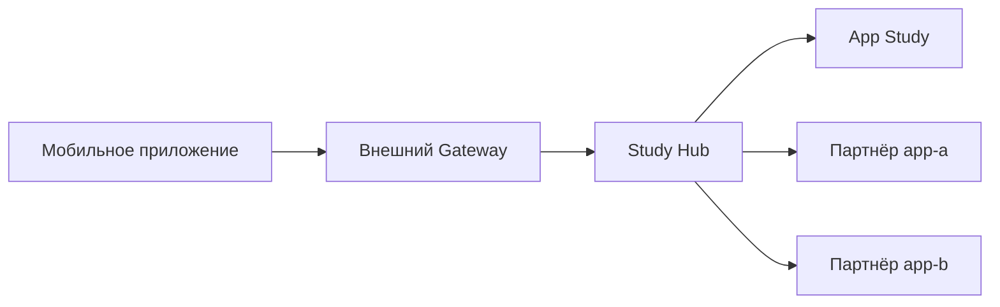

# Study Hub

> Учебный pet-проект. Репозиторий создан для изучения Java 21, Spring Boot
> и взаимодействия микросервисов. Он не является кодом
> действующей системы, не связан с конкретной организацией и не содержит
> реальных адресов, учётных данных или сведений о партнёрах.

Study Hub моделирует единую внешнюю точку доступа к условным партнёрским
приложениям. Он получает конфигурацию из учебного сервиса App Study и направляет
запрос в нужный демонстрационный микросервис по `appId`.

Study Hub не хранит конфигурацию и пользовательские сессии, не имеет
собственной БД и остаётся stateless-сервисом.

## Статус проекта

Это самостоятельный учебный пример архитектуры, а не готовый шаблон для
промышленного внедрения. Названия сервисов, namespace, realm, audience,
маршруты, роли и сетевые политики в README приведены только как примеры.

Перед использованием идей в реальном проекте необходимо отдельно согласовать
API-контракты, требования информационной безопасности, модель авторизации,
сетевую схему, управление секретами и эксплуатационные требования.

## Архитектура



В рассматриваемой учебной схеме снаружи публикуются только маршруты Study Hub.
App Study и демонстрационные партнёрские API доступны только внутри Kubernetes.

Основной поток запроса:

1. Gateway проверяет пользовательский JWT и передаёт запрос в Study Hub.
2. Study Hub получает конфигурацию приложения из App Study.
3. Для бизнес-операции Study Hub обращается к Kubernetes Service с именем `appId`.
4. Исходящий запрос содержит тот же заголовок `Authorization`, который передал Gateway.

## Технологии

- Java 21;
- Spring Boot 3.5.14;
- Spring MVC с virtual threads;
- Spring `RestClient` и Apache HttpClient 5;
- RFC 9457 Problem Details;
- springdoc-openapi;
- Logbook;
- Lombok.

## API Study Hub

Во внешнем контуре все бизнес-маршруты требуют пользовательский JWT. Его
проверяет Gateway; сам Study Hub JWT не валидирует.

| Метод | Маршрут                                                             | Назначение |
|---|---------------------------------------------------------------------|---|
| `GET` | `/hub/api/v1/catalog` | Получить дерево каталога |
| `GET` | `/hub/api/v1/applications/{appId}` | Получить конфигурацию приложения |
| `GET` | `/hub/api/v1/applications/{appId}/contracts/{contractNumber}` | Получить договор |
| `POST` | `/hub/api/v1/applications/{appId}/launch` | Получить данные для запуска приложения |

`GET /applications/{appId}` возвращает приложение в любом статусе: `ACTIVE`,
`DISABLED` или `MAINTENANCE`. Это позволяет корректно обработать deep link и
устаревшие данные клиента. Внешнее поле `financialConfiguration` содержит только
нужные клиенту `merchantId` и `serviceId`. Внутренние `paymentWebhookUrl` и
`credentialId` мобильному приложению не передаются.

`catalog` возвращает корневую группу `ecosystem`, группы первого уровня и приложения.
Для всех элементов используются общие поля `id` и `type`. У группы `id`
содержит `groupId`, у приложения — `appId`; при выборе `APPLICATION` мобильный
клиент передаёт его `id` как `{appId}` в launch или contract API. Также каталог
содержит локализованный `title`, `iconUrl`, `layout`, статус и
maintenance-сообщения. Runtime-настройки WebView и партнёрская сессия в каталог
не входят. В каталог включаются только `ACTIVE` и `MAINTENANCE`; `DISABLED`
скрывается.

Успешные ответы перечисленных бизнес-API содержат `Cache-Control: no-store`.

## Взаимодействие с App Study

Study Hub передаёт пользовательский JWT в следующие внутренние API:

```text
GET /internal/api/v1/applications/{appId}/configuration
GET /internal/api/v1/catalog
```

Текущие consumer-контракты Study Hub:

```text
HubApplicationConfigurationResponse
CatalogGroupResponse
```

DTO клиента находятся в пакете `client.appregistry.dto` и отражают сетевой
контракт App Study. Дополнительный mapper внутри Study Hub для них не нужен.

Контракты соответствуют App Study: maintenance-сообщения передаются объектом
`maintenanceMessages`, каталог содержит группы и приложения, а опциональная
финансовая конфигурация передаётся в `financialConfiguration`. Если она не
настроена, поле присутствует со значением `null`. При наличии объект содержит
`merchantId`, `serviceId`, `paymentWebhookUrl` и `credentialId`. Enum должны
иметь одинаковые значения `ApplicationStatus`, `IntegrationType`, `SessionMode`,
`GroupLayout` и `CatalogItemType`.

Это внутренний consumer-контракт Hub с App Study. Перед внешним ответом Hub
преобразует его в `ApplicationConfigurationResponse` и исключает
`paymentWebhookUrl` и `credentialId`.

В этой модели App Study является единственным владельцем конфигурации и
проверяет формат `appId` при регистрации. Перед вызовом партнёра Study Hub
проверяет, что приложение существует в App Study.

## Маршрутизация к партнёрам

В демонстрационном варианте развёртывания Study Hub и партнёрские Kubernetes
Service находятся в одном namespace. `appId` совпадает с `metadata.name`
Kubernetes Service партнёра.

Пример:

```text
appId: insurance-kasko
base URL: http://insurance-kasko
```

Внутренние контракты партнёров:

```text
GET  http://{appId}/internal/api/v1/contracts/{contractNumber}
POST http://{appId}/internal/api/v1/session/token
POST http://{appId}/internal/api/v1/session/code
```

Каждый Service предоставляет порт `80`; `targetPort` контейнеров может
отличаться. Если сервисы будут размещены в разных namespace, потребуется полный
DNS-адрес либо отдельная конфигурация маршрута.

Ответ договора не унифицирован между партнёрами, поэтому Study Hub передаёт его
как JSON-объект. Партнёрский API обязан исключить секреты и внутренние
технические поля. Пустой ответ или JSON другого типа преобразуется в
`502 Bad Gateway`.

Ожидаемая бизнес-ошибка партнёра имеет статус `422 Unprocessable Entity`:

```json
{
  "message": "Contract amount is invalid",
  "error_code": "CONTRACT_DIFFERENT_AMOUNT",
  "errors": {
    "contract": ["Contract amount is invalid"]
  }
}
```

Study Hub сохраняет HTTP-статус `422` и преобразует ответ в RFC 9457. Поле
`code` содержит стабильный код Study Hub `PARTNER_BUSINESS_ERROR`, а
`errorCode` — бизнес-код партнёра для обработки на frontend. Неизвестные поля
партнёрского ответа игнорируются. Тела технических ошибок `5xx` клиенту не
передаются.

## Запуск приложения

Мобильное приложение использует один API независимо от типа интеграции и
способа создания партнёрской сессии:

```text
POST /hub/api/v1/applications/{appId}/launch
```

Тело запроса отсутствует. JWT передаётся в заголовке:

```http
Authorization: Bearer <user-jwt>
```

Study Hub получает конфигурацию из App Study и обрабатывает её следующим образом:

- `PARTNER_WEBVIEW + TOKEN` — вызывает token API партнёра;
- `PARTNER_WEBVIEW + CODE` — вызывает code API партнёра;
- `API_FIRST + NONE` — не создаёт партнёрскую сессию.

Ответ для партнёрского WebView:

```json
{
  "appId": "insurance-app",
  "entryUrl": "https://partner.example/app",
  "session": {
    "type": "TOKEN",
    "value": "partner-session-token"
  }
}
```

Для `API_FIRST` поле `session` равно `null`:

```json
{
  "appId": "insurance-app",
  "entryUrl": "https://platform.example/app",
  "session": null
}
```

`expiresAt` отсутствует. Значение `session.value` приходит только от партнёра,
не сохраняется и не записывается в логи. Пустое значение, некорректный JSON или
недоступность партнёра преобразуются в `502 Bad Gateway`. Launch и contract
операции для приложения не в статусе `ACTIVE` возвращают `409 Conflict` с
кодом `APPLICATION_UNAVAILABLE` без вызова партнёра.

## Ошибки

REST-ошибки возвращаются в формате RFC 9457 `application/problem+json`.

| HTTP-статус | Код | Значение |
|---|---|---|
| `400` | `VALIDATION_ERROR` | Некорректные параметры запроса |
| `401` | `UNAUTHORIZED` | JWT отсутствует или отклонён внешним Gateway |
| `403` | `FORBIDDEN` | Запрос отклонён политикой внешнего Gateway |
| `404` | `APPLICATION_NOT_FOUND` | Приложение не найдено |
| `404` | `CONTRACT_NOT_FOUND` | Договор не найден |
| `409` | `APPLICATION_UNAVAILABLE` | Приложение недоступно для операции |
| `422` | `PARTNER_BUSINESS_ERROR` | Партнёр отклонил запрос по бизнес-правилам |
| `502` | `PARTNER_API_UNAVAILABLE` | Ошибка или недоступность партнёра |
| `503` | `DEPENDENCY_UNAVAILABLE` | App Study недоступен |
| `500` | `INTERNAL_ERROR` | Непредвиденная ошибка Study Hub |

Ответ также может содержать `traceId`, `correlationId` и ошибки валидации по
полям.

## Security

Study Hub не подключается к Keycloak, не декодирует JWT и не проверяет подпись,
срок действия, issuer, audience или роли. OAuth2 Resource Server, OAuth2 Client,
`client_credentials` и client secret в сервисе отсутствуют.

Hub прозрачно копирует входящий заголовок `Authorization` в запросы к App Study
и партнёрским сервисам. Если заголовка нет, исходящий вызов выполняется без
него. Поэтому прямой доступ к Hub в обход Gateway недопустим.

Gateway проверяет audience, предназначенный для внешнего API Hub. Если App
Study также проверяет переданный пользовательский JWT, токен должен содержать
и его audience, например:

```json
{
  "aud": ["hub", "app-registry"]
}
```

Audience `hub` проверяет Gateway, а `app-registry` — App Study. Study Hub эти
claims не проверяет.
Административные роли App Study (`viewer`, `admin`) обычному пользователю Study
Hub не требуются.

Если похожая схема рассматривается для production, потребуются как минимум:

- внешний Gateway маршрутизирует только в Study Hub;
- ingress NetworkPolicy разрешает вход в Study Hub только от Gateway;
- App Study и партнёры используют Service типа `ClusterIP`;
- `/internal/**` не публикуется через Ingress/Gateway;
- default-deny NetworkPolicy разрешает партнёрам вход только от Study Hub;
- egress Study Hub ограничен App Study и partner-подами;
- внутренний HTTP защищён mTLS/service mesh;
- на Gateway настроен rate limit для launch и contract API;
- контейнеры запускаются не от `root`.

Если Study Hub или партнёр не проверяет JWT криптографически, он может доверять
токену только при гарантированной сетевой изоляции и защищённом соединении с
Gateway. Более безопасный вариант — повторная JWT-валидация в каждом сервисе.

Реальные секреты хранятся в Vault/Kubernetes Secret и не передаются в Study Hub
или мобильное приложение. `credentialId` может быть только непрозрачной ссылкой
на секрет.

## Логирование

Учебный профиль `prod` демонстрирует структурированные JSON-логи. В MDC
добавляются `traceId` и `correlationId`, эти же заголовки передаются в
зависимости.

Логируются:

- ошибки и недоступность App Study;
- ошибки партнёрских сервисов без тела ответа;
- успешная подготовка запуска — только `appId`, `integrationType` и `sessionMode`;
- отклонение launch-запроса для недоступного приложения;
- непредвиденные ошибки со stack trace.

Не логируются:

- JWT и заголовок `Authorization`;
- `session.value`, партнёрские `token` и `code`;
- номер и содержимое договора;
- тела launch/session/contract запросов и ответов;
- секреты и credential-related поля.

## Конфигурация

Пример переменных для профиля `prod`:

| Переменная | Назначение |
|---|---|
| `APP_REGISTRY_BASE_URL` | Внутренний URL App Study |
| `APP_PROBLEMS_BASE_URI` | Базовый URI типов Problem Details |

Настройки исходящих HTTP-вызовов:

| Переменная | Значение по умолчанию |
|---|---|
| `OUTBOUND_HTTP_CONNECT_TIMEOUT` | `2s` |
| `OUTBOUND_HTTP_READ_TIMEOUT` | `3s` |

Virtual threads включены через `spring.threads.virtual.enabled=true`.

## Локальный запуск

Для локального запуска Study Hub требуются JDK 21 и учебный App Study на `8082`.
Keycloak самому Hub не нужен. Значения по умолчанию предназначены только для
локальной разработки.

App Study можно запустить на требуемом порту так:

```bash
SERVER_PORT=8082 ./gradlew bootRun
```

Затем запускается Study Hub:

```bash
SPRING_PROFILES_ACTIVE=local ./gradlew bootRun
```

В IntelliJ IDEA укажите `local` в поле **Active profiles**.

Swagger UI:

```text
http://localhost:8080/swagger-ui
```

Профиль `local` позволяет проверить конфигурационные API. Вызовы партнёров по
`http://{appId}` из процесса IntelliJ не работают, потому что Kubernetes DNS
доступен только внутри кластера. Для полной проверки используйте один из
вариантов:

1. запустите Study Hub и партнёров в одном локальном Kubernetes namespace;
2. запустите их в общей Docker Compose network;
3. добавьте отдельное local-only сопоставление `appId -> localhost URL`.

При локальном Kubernetes наружу достаточно пробросить только Study Hub:

```bash
kubectl -n demo-platform port-forward service/hub 8080:80
```

## Проверка

```bash
./gradlew test
```

Перед фиксацией изменений полный набор тестов должен проходить без ошибок.
Отдельно необходимо сверять consumer-контракты Study Hub с фактическими
JSON-ответами учебного App Study и демонстрационных партнёрских сервисов, а не
только с вручную созданными mock-ответами.

## Учебный профиль `prod`

Профиль `prod`:

- отключает Swagger UI и OpenAPI endpoint;
- скрывает детали health-check;
- включает структурированные JSON-логи;
- требует явной передачи обязательных переменных окружения.

Наличие этого профиля показывает различие локальных и production-like настроек,
но само по себе не означает готовность приложения к эксплуатации в реальной
инфраструктуре.

Outbox, JPA, Flyway, Kafka и брокер сообщений в Study Hub не нужны: сервис не
изменяет собственные данные и не публикует события.
